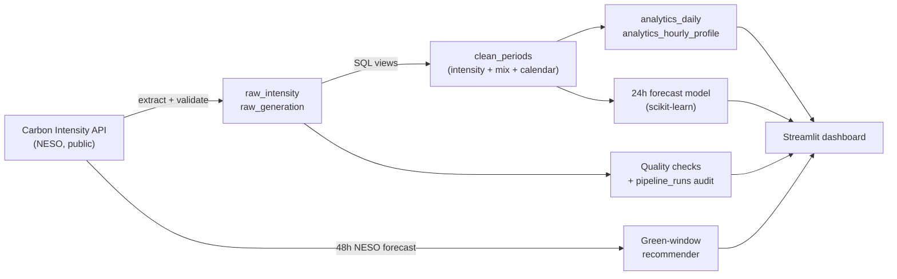

# UK Grid Carbon Intelligence

**Helping UK organisations cut emissions by running energy-heavy work when the electricity grid is greenest.**

An end-to-end data and AI project: an automated data pipeline, a layered SQL warehouse with data quality checks, a machine learning forecast evaluated against the grid operator's own forecast, and a decision dashboard that turns all of it into one recommendation: *when should we run this job, and how much CO2 does that save?*

**Live dashboard:** _add your Streamlit link here_

---

## 1. The business problem

The carbon intensity of Great Britain's electricity changes by the half-hour. On a windy night it can be under 50 gCO2/kWh; on a still winter evening, when gas plants fill the peak, it can be several times higher.

Many workloads do not care *when* they run, only that they finish: overnight data processing, model training, EV fleet charging, cold-store pre-cooling, industrial batch runs. Moving that flexible demand into greener periods cuts Scope 2 emissions at zero cost and requires no new equipment.

This project answers three questions a sustainability or operations lead would ask:

1. **When is the best time to run a flexible job in the next 48 hours?**
2. **How much CO2 would that save versus running it now?**
3. **Can we trust the forecast behind the recommendation?**

## 2. What it does

| Layer | What it does | Where |
|---|---|---|
| **Extract** | Pulls half-hourly carbon intensity and generation mix from the public [Carbon Intensity API](https://carbonintensity.org.uk) (NESO). Validates every response, retries transient failures, splits long ranges into chunks the API accepts. | `gridcarbon/extract.py` |
| **Load and transform** | Idempotent upserts into a layered SQL warehouse: `raw` (as received), `clean` (typed, pivoted, joined), `analytics` (daily trend, hourly profile). | `gridcarbon/warehouse.py` |
| **Govern** | Five automated data quality checks (plausible ranges, mix sums to 100%, missing joins, time-series gaps, late actuals) and an audit table recording every pipeline run. | `gridcarbon/quality.py` |
| **Predict** | Gradient-boosted model forecasting intensity 24 hours ahead, evaluated on unseen data against a naive baseline and NESO's official forecast, with error broken down by time of day and permutation feature importance. | `gridcarbon/forecast.py` |
| **Decide** | Finds the lowest-carbon window for a job of any length and quantifies the CO2 saved. | `gridcarbon/recommend.py` |
| **Present** | Streamlit dashboard for decision-makers. | `streamlit_app.py` |
| **Automate** | GitHub Actions: type checks and tests on every push; the full pipeline and model retrain daily. | `.github/workflows/` |

## 3. Architecture



The warehouse follows the **medallion pattern** (bronze/raw, silver/clean, gold/analytics) used on platforms such as Databricks and Snowflake, implemented at laptop scale in SQLite so anyone can run it with no cloud account.

## 4. Results

Tested on 90 days of real GB grid data (July to October 2026), forecasting 24 hours ahead on unseen data:

| 24h-ahead forecast (test set) | MAE (gCO2/kWh) |
|---|---|
| This project's ML model | 38.8 |
| Naive: same time yesterday | 47.7 |
| NESO official forecast | 10.3 |

The model is **19% more accurate than the naive baseline**, which shows it has learnt real structure (daily cycles, the effect of wind and solar). NESO's forecast uses live weather forecasts this model does not have and is issued closer to each period, so it is the benchmark to aim for rather than a baseline. For that reason the dashboard's recommendations use NESO's forecast. Choosing the most accurate tool for the decision, rather than the one we built, is deliberate.

## 5. Trustworthy AI and data governance

- **Validated inputs:** malformed API responses fail loudly at the boundary instead of corrupting reports.
- **Quality gate:** five SQL checks run after every load; failures are surfaced in the dashboard, not hidden.
- **Lineage:** `pipeline_runs` records when each run happened, what window it covered, row counts and quality status.
- **No leakage:** features only use data available 24 hours before the target; train/test split is time-ordered.
- **Honest benchmarking:** the model is compared against both a naive baseline and the industry forecast.
- **Explainability:** permutation importance shows which inputs drive predictions; errors are sliced by time of day to show where the model is weakest.
- **Documented limits:** see the [model card](docs/model_card.md).

## 6. How this would scale for a client

| This project | Production equivalent |
|---|---|
| SQLite warehouse | Databricks Delta Lake, Snowflake or Azure SQL |
| Python ETL script | Databricks Lakeflow Jobs, Azure Data Factory or Airflow |
| GitHub Actions schedule | Cloud scheduler with alerting on failed runs |
| Quality checks in SQL | Great Expectations or Delta Live Tables expectations |
| scikit-learn model | MLflow-tracked model with drift monitoring |
| Streamlit | Power BI or an internal web app behind single sign-on |
| National data | Regional intensity per site, plus actual metered consumption |

## 7. Run it yourself

Requires Python 3.12.

```bash
git clone https://github.com/CourageCodeJourney/uk-grid-carbon-intelligence.git
cd uk-grid-carbon-intelligence
python -m venv .venv
source .venv/bin/activate          # Windows: .venv\Scripts\activate
pip install -r requirements-dev.txt

python -m gridcarbon.pipeline --days 90   # build the warehouse
python -m gridcarbon.forecast             # train and evaluate the model
streamlit run streamlit_app.py            # open the dashboard
```

Quality checks:

```bash
mypy                       # strict static type checking
python -m unittest -v      # 26 tests, run fully offline against a fake API
```

## 8. Project structure

```
gridcarbon/
  config.py      all tunable settings in one place
  extract.py     typed API client with validation, chunking and retries
  warehouse.py   SQLite schema, idempotent loads, medallion views, run audit
  quality.py     data quality checks
  pipeline.py    end-to-end ETL command
  forecast.py    feature engineering, training, evaluation, explainability
  recommend.py   greenest-window search and CO2 savings
streamlit_app.py dashboard
tests/           offline unit and integration tests
docs/            model card
```

## 9. Next steps

- Natural-language assistant: ask "When should I charge 20 vans tonight?" and get an answer grounded in the warehouse.
- Regional intensity, so multi-site organisations get a recommendation per site.
- Weather features (wind speed, solar irradiance forecasts) to close the gap with NESO.
- Port the warehouse to Databricks Community Edition.

## Data source

Carbon intensity and generation mix data from the [Carbon Intensity API](https://carbonintensity.org.uk), developed by National Energy System Operator (NESO) with partners. See their site for terms of use.
